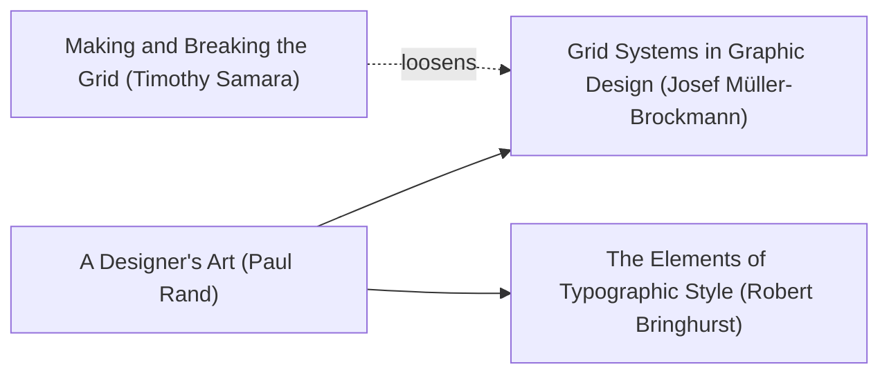

# Design log: CINEVERSE (dada)

## Traversal Plan
**Brief (owner, verbatim):** "Use vue js read prompt build site for this with dada push main" for `design/master-prompt.md` (CINEVERSE, an interactive movie connection atlas). The owner's wider aim: use more JS frameworks on public repos, with this repo as the Vue showcase.
**Mode:** Adaptive. A public audience explores films; the advanced pole is a distinctive cinematic atlas (not a streaming UI), the acceptable pole is that anyone can search a film, follow its connections and understand why they exist. **Run type:** Full (empty repo apart from the brief). Interpretation of "website ships Shadw- and Vercel-configured": done as a committed static `site/` built from a Vue app in `app/` (the host has no build step).
**Tooling inventory:** graph/diagram tool: none available (Mermaid text below). Task tool: none used. Panel: sub-agent tool (one agent per seat, reports on disk). Measurement: Playwright against the built static site; Wikidata SPARQL and Wikipedia API for data; `node --test` via tsx; `vue-tsc`. R0 premortem: not applicable (nothing inherited to judge).
**Seed (labels from the anchor graph):** Stance *A Designer's Art (Paul Rand)*; Rules *Grid Systems in Graphic Design (Josef Müller-Brockmann)*, *The Elements of Typographic Style (Robert Bringhurst)*; Breaker *Making and Breaking the Grid (Timothy Samara)*; counterpoint (dotted) *samBreak -.->|loosens| mb*. The solid chain from the stance to the two rules is not fully drawn in the graph; recorded, not invented.

**Palette (topic-derived):** the topic is film, so the hue source is the **SMPTE colour bars** (the signal labs and broadcasters calibrate to): yellow, cyan, green, magenta, red, blue and the +Q purple patch. They are 75%-amplitude bars on black, so each hue angle is kept and lifted in CIELAB to read on near-black (`scripts/palette.mjs`). Result, one hue per relationship category: franchise `#ff4813`, trilogy `#f216ff`, director `#01d3ff`, cast `#00c581`, crew `#f55d97`, genre `#7282fc`, adaptation `#b3e900`; inferred links are neutral grey and dashed. Measured: minimum pairwise ΔE76 **64.6** including the reserved gold signal `#c9a45c`; every hue ≥ 5.3:1 on `#17151a`. Zones: the hero is a gold-washed night, franchise pages take a red wash, trilogies magenta, people cyan, genres the genre's own hue, timeline green, six degrees green-cyan, library pink. Dark theme only (the brief asks for dark by default; no light palette was measured).
**First screen:** one composed figure that summarises the whole site: a live slice of the movie map (centre film and its strongest factual neighbours, from the real engine) above eight tiles, one per part of the site (map, franchises, trilogies, people, timeline, genres, six degrees, collections), each with a computed figure and a link.

## Frontier
| Candidate | Reached via | From | Status |
|---|---|---|---|
| Real-data engine before any chrome | grounds | Rand (form follows the idea) | TAKEN M1 |
| Landing figure = live map slice + one tile per topic | breaks | Samara | TAKEN M2 |
| Explore layout: sidebar, map, panel, strip (brief §3) | grounds | Müller-Brockmann | TAKEN M3 |
| Factual vs inferred shown the same way everywhere (dashed + label) | grounds | Bringhurst (clarity) | TAKEN M4 |
| Generated title cards instead of posters | rights | brief §17 | TAKEN M5 |
| Backend, accounts, admin, TMDB, movements | out of scope | brief §21–22 | DEFERRED (documented in docs/ROADMAP.md) |
| Light theme | brief §3 | n/a | DEFERRED (not requested) |

## Decision Records
**M1 Data and engine first (KEEP-THE-RULE).** Depends on: none. Anchors: Stance Rand; Rule Müller-Brockmann (a stable system under the surface). Intent: nothing on screen before there is a real dataset: 1,000+ films with real credits, so no connection is random. Wikidata (CC0) via SPARQL, Wikipedia leads for text, a documented selection rule, a country-balance rule so the catalog is not only English-language. Alternatives rejected: TMDB (needs a key and forbids redistribution of images); hand-typing 100 films (would be fabricated-by-omission and not scale). Consequence: cast billing order is rare in Wikidata, so "lead actor" links are weaker than the brief imagines; this is disclosed in the UI and docs. Fence: relationships are computed from stored facts, never stored as free edges.
**M2 Landing figure (BREAK).** Depends on: M1. Anchors: Rule Grid Systems; Breaker Samara; counterpoint samBreak -.-> mb. Intent: replace the streaming-service poster wall with the product itself: a real slice of the map, a title card at the centre, ribbons in the relationship hues, an explanation sentence under it, and a tile per section. Advanced pole: a bespoke constellation instead of a hero image. Acceptable pole: the sentence under the figure says in words why the strongest line exists, and the tiles carry plain names and counts. Alternatives rejected: a full-bleed poster collage (rights, and says nothing about connection); a dense 150-node hero (overplotted; dada lesson on legibility). Fence: a calm default state (one film, at most eight neighbours), density is one click away on the map.
**M3 Explore layout (KEEP-THE-RULE).** The brief's five-region layout: top navigation, left exploration sidebar, the map as most of the screen, a right information panel, a bottom year strip. On narrow screens the sidebar is a drawer, the panel a bottom sheet that stays closed until a node is tapped. Cytoscape is only a renderer over the single graph model (`src/lib/graph.ts`); D3 draws the separate charts.
**M4 Facts and inferences look different everywhere (KEEP-THE-RULE).** Solid line = Wikidata fact; dashed = inferred or editorial; FACT / INFERRED text beside every relationship; similar-films ranking blends both but each reason keeps its own label.
**M5 Title cards (BREAK).** Posters are not redistributed. Each film gets a generated card from its own data (title, year, genre hue) and every page says so. Alternatives rejected: Wikimedia Commons images (most posters are not free), hot-linking posters (rights).
